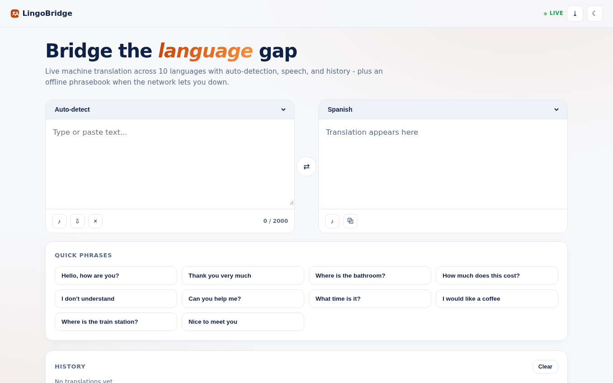
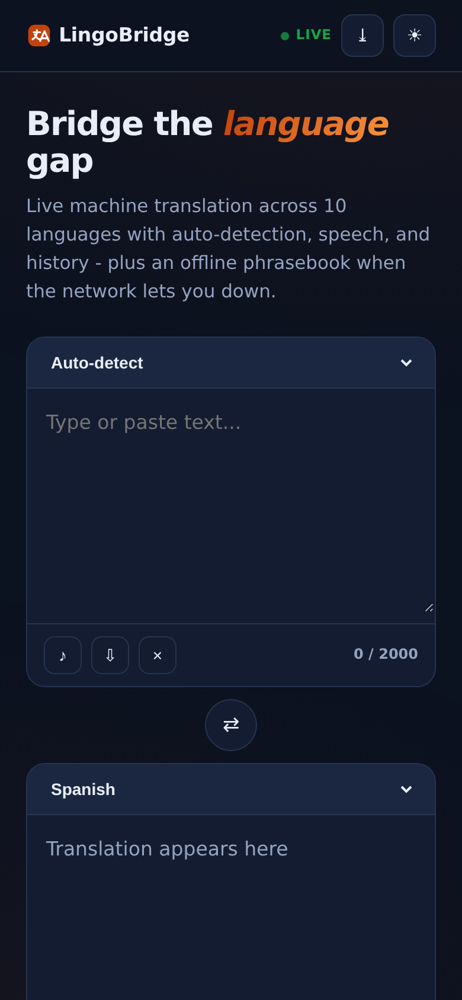

# LingoBridge - Translator

Live machine translation across 10 languages with **auto-detection, speech, history, and an offline phrasebook fallback** - free, no API key, installable.

**Live demo:** https://akash991833.github.io/translator-app/

## Features

- **Live translation** via the free keyless MyMemory API, debounced as you type, with a visible LIVE / OFFLINE MODE badge
- **Auto-detect** - Unicode script detection (Devanagari, Cyrillic, CJK, kana) plus stopword voting for European languages, honestly labeled as heuristic
- **10 languages** - English, Spanish, French, German, Hindi, Portuguese, Italian, Russian, Japanese, Chinese
- **Swap** with one tap, carrying the translated text back to the source box
- **Speech** in native locales (Web Speech API), copy, paste, character counter
- **History** - last 40 translations, click to restore, persisted locally
- **Offline resilience** - per-pair translation cache plus a built-in phrasebook; the app tells you exactly which mode it is in
- **Quick phrases** grid for travelers
- **PWA** - installable
- **Premium UI** - white professional design, navy ink, orange accent, dark + light themes, responsive desktop and mobile

## Screenshots

## Honest limits

MyMemory's free tier has a daily anonymous quota; when it or the network runs out, the app falls back to cached translations and the phrasebook and says so. Auto-detect is heuristic and can miss on very short text.

## Tech

Vanilla HTML/CSS/JS. Translation: MyMemory API (free, no key).

## Run locally

Open `index.html` or serve the folder (`python3 -m http.server`).
